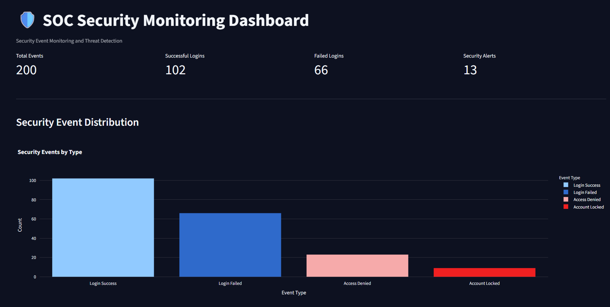
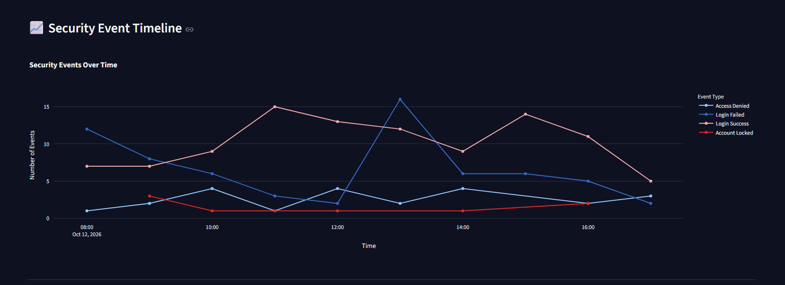
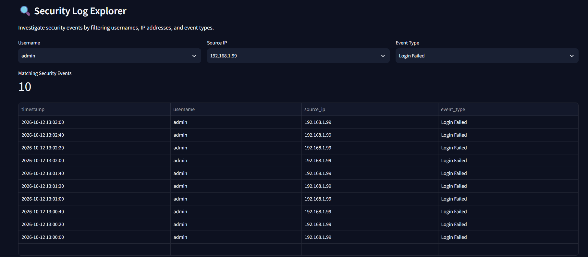
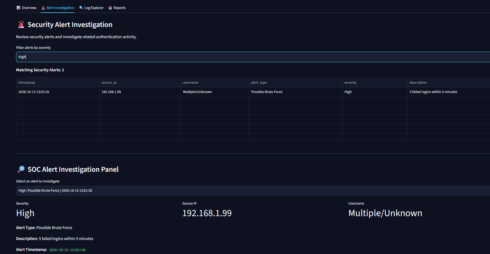

# SOC Security Monitoring Dashboard

A Python-based cybersecurity project that analyzes
simulated security logs, detects suspicious login
activity, and visualizes security events using
an interactive Streamlit dashboard.

## Project Overview

This project demonstrates basic Security Operations
Center (SOC) monitoring and threat detection.

It processes simulated authentication logs,
identifies suspicious activity using rule-based
detection, and generates security alerts.

## Technologies Used

- Python
- Pandas
- Streamlit
- Plotly
- CSV

## Features

- Security event monitoring
- Successful and failed login analysis
- Rule-based brute-force detection
- Repeated account failure detection
- Account lockout monitoring
- Security alert severity classification
- Interactive log filtering
- Security event timeline
- Security alert visualizations
- CSV report downloads

## Detection Rules

| Detection | Condition | Severity |
|---|---|---|
| Possible Brute Force | 5 failed logins from one IP within 5 minutes | High |
| Repeated Account Failures | 10 failed logins for one account | Medium |
| Account Lockout | Account Locked event | Low |

These thresholds are for demonstration purposes.

## Project Results

The included simulated dataset contains:

- Total Security Events: 200
- Successful Logins: 102
- Failed Logins: 66
- Security Alerts: 13
- High Severity Alerts: 1
- Medium Severity Alerts: 3
- Low Severity Alerts: 9

## Installation

1. Clone the repository.

2. Navigate to the project directory.

3. Create a virtual environment:

   python -m venv .venv

4. Activate the environment.

   Windows:
   .venv\Scripts\activate

5. Install dependencies:

   python -m pip install -r requirements.txt

## Running the Project

Generate simulated security logs:

    python generate_logs.py

Analyze security events:

    python analyze_logs.py

Run the threat detection engine:

    python detect_threats.py

Launch the dashboard:

    python -m streamlit run dashboard.py

## Screenshots

### Dashboard Overview

### Security Event Timeline

### Security Log Explorer

### Security Alert Analysis

## Limitations

- Uses simulated security events.
- Uses predefined detection thresholds.
- Does not monitor live security logs.
- Alerts indicate suspicious patterns,
  not confirmed security incidents.

## Future Improvements

- Real-time log ingestion
- Additional detection rules
- MITRE ATT&CK technique mapping
- Alert investigation workflow
- Support for additional log formats

## Disclaimer

This project is intended for cybersecurity
education and defensive security analysis.
